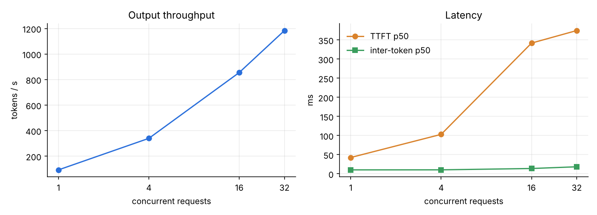

# Mock dry run

Pipeline check against `deploy/mock_server.py`. **These are simulated numbers, not a GPU benchmark.** Run the Colab notebook for real ones.

**Setup:** MOCK SERVER dry run (not a GPU benchmark) · model `mock/llama-3.2-1b` · max 64 output tokens · 2026-11-25 21:25:35

- **TTFT (1 user):** 43 ms p50
- **Inter-token latency (1 user):** 10 ms p50 (≈ 98 tok/s per stream)
- **Peak throughput:** 1184 tok/s at 32 concurrent requests

| concurrency | requests | errors | output throughput (tok/s) | req/s | TTFT p50 / p90 (ms) | inter-token p50 / p90 (ms) | e2e latency p50 / p90 (s) |
|---:|---:|---:|---:|---:|---:|---:|---:|
| 1 | 32 | 0 | **93** | 1.45 | 43 / 43 | 10 / 10 | 0.69 / 0.69 |
| 4 | 32 | 0 | **340** | 5.31 | 103 / 104 | 10 / 10 | 0.75 / 0.76 |
| 16 | 32 | 0 | **855** | 13.37 | 342 / 343 | 14 / 14 | 1.18 / 1.22 |
| 32 | 32 | 0 | **1184** | 18.50 | 375 / 627 | 18 / 19 | 1.53 / 1.70 |

| server metric (vLLM /metrics) | mean | p50 | p90 | p99 |
|---|---:|---:|---:|---:|
| time to first token (s) | 0.187 | 0.175 | 0.470 | 0.714 |
| inter-token latency (s) | 0.013 | 0.015 | 0.019 | 0.020 |
| end-to-end latency (s) | 1.008 | 0.938 | 2.172 | 2.467 |
